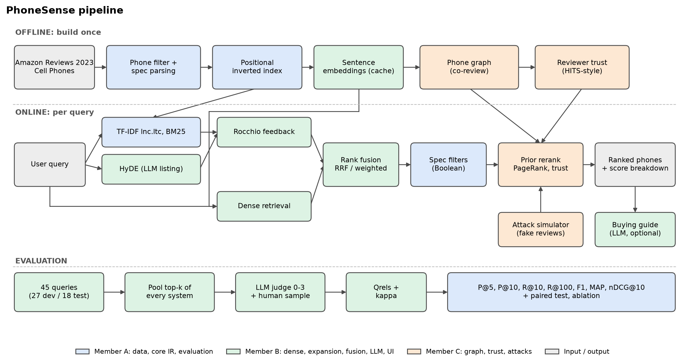

# Proposed Model

> **Status: draft (owner: B).** Formulas and parameters live in the Methodology section; this
> section explains how the pieces fit and why. Items that depend on final results are marked
> `[TBD]`.

*Figure: the PhoneSense pipeline. Colours show who built each stage (A, B, C); the dashed lines
separate offline preparation, the per-query path and the evaluation loop. Regenerate with
`python scripts/make_pipeline_figure.py`.*

## 1. Overview

PhoneSense answers a free-text need with a ranked list of phones. It is a **hybrid** system: a
lexical stage and a dense stage retrieve candidates in different ways, feedback and LLM
expansion help the lexical stage use the right words, rank fusion merges the lists, Boolean
filters enforce hard numeric constraints, and a prior built from the phone graph and from
reviewer trust nudges the final order. A separate loop builds the test collection and measures
every stage with the same metrics.

## 2. Offline stage (built once)

1. **Data.** Phones and their reviews come from Amazon Reviews 2023 (Cell Phones and
   Accessories). A heuristic filter removes cases, chargers and other accessories; a parser
   turns free text into typed specs (RAM, storage, battery, screen, camera, OS, 5G, year) and
   writes `null` whenever it cannot tell. Unknown is never guessed.
2. **Positional inverted index** over the phone text (title, features, description), with
   document lengths and a forward index. The same text analysis is used for phones and queries.
3. **Sentence embeddings** of every phone, cached on disk, for dense retrieval.
4. **Phone graph** from co-review links (two phones rated by at least two of the same
   reviewers), for PageRank. Nearest-neighbour edges in embedding space are supported but not
   used in the final run.
5. **Reviewer trust**: an iterative score in which phone quality and reviewer reliability
   reinforce each other, compared with the raw, Bayesian and helpful-vote averages.

## 3. Online stage (per query)

| Stage | What it does | Why it is there |
|---|---|---|
| Lexical (TF-IDF lnc.ltc, BM25) | Exact-term matching over the index. | Strong on model names and spec words ("Pixel 7a", "5000mAh"). |
| Dense retrieval | Cosine similarity between query and phone embeddings. | Finds phones that say the same thing in other words. |
| Rocchio feedback | Treats the top results of a first pass as relevant and adds their terms to the query. | Cheap query refinement; the risk is drift when the first pass is wrong. |
| HyDE-style expansion | An LLM writes a hypothetical listing; its terms are weighted in with Rocchio. | Bridges the vocabulary gap ("lasts two days" versus "6000mAh"). Only reweights terms, so invented specs never reach the user. |
| Rank fusion (RRF, weighted linear) | Merges the rankings of the selected systems. | Systems fail on different queries; fusion uses ranks, so scores need no calibration. |
| Boolean spec filters | Keeps only phones that satisfy numeric constraints; unknown values never pass. | "Under $300 with 8 GB RAM" is a constraint, not a word match. |
| Prior rerank (PageRank, trust) | `(1 - lambda) * score + lambda * prior` on the top 100; never adds phones. | Uses information that text does not contain: which phones the same people review, and which ratings to trust. |

Every stage can be switched on and off in the demo, and every result shows a **score
breakdown** (rank and raw score from each selected system, plus the prior values), so a ranking
can be explained rather than just trusted. An optional **buying guide** asks an LLM to
summarise the top results from the listed facts only; figures that are not in the data are
flagged.

## 4. Evaluation loop

45 queries (spec, aspect, model, vague) are split into 27 dev and 18 test. For each query we
**pool** the top results of every system, an LLM judge grades them 0-3, and people grade a
shared sample so that agreement can be measured (Cohen's kappa). Final qrels use the human grade
where one exists. All settings are tuned on dev; test is used once per final configuration.
Metrics are P@5, P@10, R@10, R@100, F1, MAP and nDCG@10, with a paired test and an add-one /
leave-one-out ablation `[results TBD]`.

## 5. Design decisions and trade-offs

* **Own code for the core IR** (TF-IDF, BM25, fusion, PageRank, Rocchio): the course asks for it,
  and it keeps every score explainable. Libraries are used only to cross-check in tests.
* **Fusion by rank (RRF) as the default**, because it needs no tuning of score scales; the
  weighted linear variant is tuned on dev and reported next to it.
* **LLM output never becomes a document.** HyDE text only reweights query terms, and the buying
  guide may only restate listed facts. This limits, but does not remove, the risk of invented
  content.
* **Honest about unknowns.** A missing spec is `null`, a filter never matches on `null`, and the
  judge is told that an unknown spec cannot be assumed to satisfy a requirement.
* **Everything replayable.** Every LLM call is logged and replayed, so a rerun gives the same
  numbers and does not need an API key.

## 6. What is new and what already existed

Existing ideas we implement and compare: TF-IDF, BM25, Rocchio, dense retrieval with sentence
encoders, HyDE, RRF, PageRank. Weighting HyDE's expansion terms with Rocchio for a sparse
retriever is **not ours**: Jedidi and Lin (2025) proposed and evaluated it, and we apply their
idea to phone search `[verify the details against the paper before describing our variant]`.

What we contribute is the **combination and evaluation on a spec-heavy, review-rich product
domain**: all of these rankers on one test collection with graded labels and a measured judge
agreement, an ablation of what each adds, a reviewer-trust score evaluated under simulated
attacks (own design, inspired by HITS), and a demo that exposes every component. We do not claim
a new retrieval model `[confirm against results]`.
