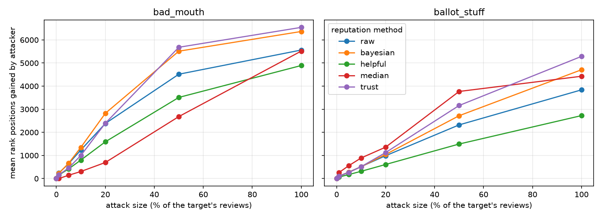
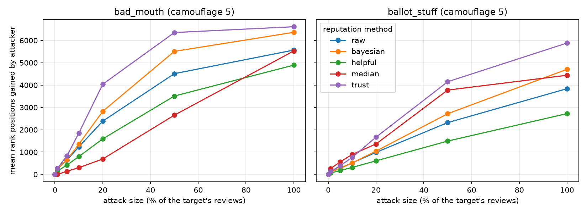

# 8.5 Graph and reputation signals, and the review-attack study

> Report section R-C2 (owner C). Every number comes from the real data release (data-v1) and
> the scripts named next to it; nothing here is from the toy data used in tests.

## 8.5.1 Data the graph and trust methods see

The processed collection has 7,166 phones and 575,816 reviews from 489,887 reviewers
(`scripts/build_trust.py`, `results/trust_stats.json`). Three properties of these reviews
shape everything that follows.

* **Ratings are skewed to the extremes.** 52% of reviews give 5 stars and 19% give 1 star;
  the middle three grades share the remaining 29%.
* **Most reviewers write once.** 88.4% of reviewers have a single review in the collection.
  The 56,969 repeat reviewers (11.6%) wrote 24.8% of all reviews, at most 41 each.
* **Coverage per phone is uneven.** The median phone has 20 reviews (quartiles 9 and 59);
  the most reviewed has 8,215. 3,664 phones have at least 20 reviews.

89.5% of reviews are verified purchases, and 62.1% have no helpful votes.

## 8.5.2 The co-review graph and PageRank

Linking two phones when at least two reviewers rated both (7.5) gives 15,323 undirected
pairs, written as 30,646 directed edges (`scripts/build_graph.py`,
`results/graph_stats.json`).

| Property | Value |
|---|---|
| Phones with at least one edge | 2,757 (38.5%) |
| Isolated phones (no edge) | 4,409 (61.5%) |
| Largest connected component | 2,636 phones |
| Out-degree of linked phones | median 3, maximum 625 |
| PageRank iterations ($d = 0.85$, tolerance $10^{-8}$) | 74, in 0.014 s |

The graph is sparse because few reviewers rate more than one phone (8.5.1). Isolated phones
still receive the teleport share of PageRank, so every phone has a score, but the prior
can only separate the 38.5% of phones that are linked. Section 8.5.4 also tests a second graph
that adds the semantic kNN edges (7.5): each phone is linked to its 8 nearest neighbours by
cosine similarity of the dense embeddings. That graph has 85,883 directed edges, no isolated
phone and a single connected component of all 7,166 phones.

As a sanity check, the phones with the highest PageRank are widely reviewed, long-selling
models: the Samsung Galaxy S3 Mini (5,437 ratings), the BLU Advance 5.5 HD (3,960) and the
second-generation Motorola Moto G (2,370). PageRank here behaves as a popularity and
centrality signal, which is what the prior is meant to capture.

## 8.5.3 Reviewer trust on real data

The trust iteration (7.7) converged in 9 rounds. Because most reviewers have one review,
their reliability stays close to the prior of 0.5: the median reliability is 0.56 and 90%
of reviewers fall between 0.44 and 0.62. Trust-weighted phone quality differs from the
Bayesian average by 0.091 stars on average (largest difference 0.43 stars). In other words,
on this collection the trust score is a modest correction to the Bayesian average, driven by
the quarter of reviews written by repeat reviewers.

## 8.5.4 Effect of the priors on ranking

Each prior reranks the tuned BM25 run ($k_1 = 1.2$, $b = 0.9$; 8.3) with
$s' = (1-\lambda)\,\hat s + \lambda\,p$ (7.8). $\lambda$ was chosen from
$\{0.1, 0.2, 0.3, 0.5\}$ by nDCG@10 on the dev queries, and the test queries were run once with
the chosen value (`scripts/run_rerank.py`). Queries with no relevant phone are left out of the
averages (4 dev, 2 test; 8.1), leaving 23 dev and 16 test queries.

*Table 8.5d. Reranking tuned BM25 with each prior. $\Delta$ is the change in nDCG@10 against
tuned BM25; $p$ is the paired randomization test, Holm-corrected over the three priors. No
difference is significant at 0.05.*

| System | $\lambda$ | Dev nDCG@10 | Test P@10 | Test MAP | Test nDCG@10 | Test $\Delta$ | $p$ (Holm) | Better / worse queries |
|---|---:|---:|---:|---:|---:|---:|---:|---:|
| BM25 tuned | – | 0.600 | 0.381 | 0.591 | 0.663 | – | – | – |
| + PageRank | 0.1 | 0.582 | 0.375 | 0.594 | 0.660 | −0.003 | 0.78 | 3 / 3 |
| + Personalized PageRank | 0.1 | 0.586 | 0.381 | 0.598 | 0.671 | +0.008 | 0.29 | 6 / 1 |
| + Reviewer trust | 0.2 | 0.590 | 0.381 | 0.604 | 0.674 | +0.011 | 0.12 | 8 / 1 |

**The priors neither help nor hurt measurably.** On dev, every prior and every $\lambda$
scored below tuned BM25, and accuracy fell steadily as $\lambda$ grew (at $\lambda = 0.5$,
nDCG@10 drops to 0.49-0.56). On test, with the dev-chosen weights, trust and personalized
PageRank come out slightly ahead and global PageRank slightly behind. The test gains are small,
they reverse the dev result, and none survives the correction for three comparisons (trust's
unadjusted $p$ is 0.04), so we read them as noise on 16 queries rather than as an
improvement.

**What the priors change.** At the chosen weights the priors reorder results more than they
replace them. Trust changes 4.3 of the top-10 positions per dev query (4.9 on test) but brings
only about one new phone into the top 10; global PageRank never changes the top result on dev
or test; personalized PageRank only reshuffles phones BM25 already ranked in the top 10
(0.1 new phones per query), because its seeds are those same results.

**Pooling favours the baseline.** The reranked runs were not in the judging pool (8.1). Global
PageRank and trust pull in phones that were never judged, so their share of judged phones in
the top 10 falls (0.65 and 0.67 against 0.70 on dev), and those phones count as non-relevant.
The dev losses for those two priors are therefore partly an artefact of pooling; personalized
PageRank, which keeps the judged share at 0.70, is not affected.

**Connecting every phone does not help.** To test whether the 61.5% of isolated phones explain
the null result, we reran the two graph priors on the co-review + kNN graph (8.5.2), choosing
$\lambda$ on dev from the same grid and running test once (`scripts/build_graph.py
--embeddings`, `scripts/run_rerank.py --tag`).

*Table 8.5e. Graph priors on the co-review graph and on the co-review + kNN graph. $p$ is the
paired randomization test against tuned BM25, Holm-corrected over the two kNN rows.*

| System | $\lambda$ | Dev nDCG@10 | Test nDCG@10 | Test $\Delta$ | $p$ (Holm) | Better / worse queries |
|---|---:|---:|---:|---:|---:|---:|
| BM25 tuned | – | 0.600 | 0.663 | – | – | – |
| + PageRank, co-review | 0.1 | 0.582 | 0.660 | −0.003 | – | 3 / 3 |
| + PageRank, co-review + kNN | 0.1 | 0.589 | 0.662 | −0.001 | 0.96 | 6 / 4 |
| + Personalized PageRank, co-review | 0.1 | 0.586 | 0.671 | +0.008 | – | 6 / 1 |
| + Personalized PageRank, co-review + kNN | 0.5 | 0.603 | 0.636 | −0.026 | 0.005 | 1 / 10 |

Global PageRank is unchanged: its top phones are still the same widely reviewed models, and
test nDCG@10 moves by 0.001. Personalized PageRank on the kNN graph is the only prior in this
study that scored above tuned BM25 on dev (+0.003, at $\lambda = 0.5$, the largest weight
tried), but on test the same setting is significantly worse: −0.026 nDCG@10, worse on 10 of the
16 queries. With kNN edges the walk spreads from a query's top results to similar listings and
brings about one new phone per query into the top 10, many of them unjudged (judged@10 falls
from 0.62 to 0.59 on test), so pooling explains part of the loss, though not a loss on 10 of 16
queries. The small dev gain did not carry over. The sparse co-review graph is therefore not why
the graph priors fail: kNN edges are built from the same listing text that BM25 and dense
retrieval already use, so they add no new evidence about relevance.

**The result does not depend on damping or neighbourhood size.** As a sensitivity check (not a
second round of tuning, which 23 dev queries cannot support) we reran both graph priors with
$\lambda = 0.1$ for damping $d \in \{0.5, 0.7, 0.85, 0.95\}$ on both graphs, and for
$k \in \{4, 8, 16, 32\}$ kNN neighbours at $d = 0.85$ (`scripts/build_graph.py --knn-k`,
`scripts/run_rerank.py --damping`).

*Table 8.5f. Change in test nDCG@10 against tuned BM25 (0.663) for each setting, $\lambda = 0.1$.
None of the 22 settings is significant (paired randomization test, Holm-corrected over all 22:
every $p = 1.00$).*

| Graph | Setting | PageRank | Personalized PageRank |
|---|---|---:|---:|
| Co-review | $d$ = 0.5 / 0.7 / 0.85 / 0.95 | −0.003 at every $d$ | +0.008 at every $d$ |
| Co-review + kNN ($k$ = 8) | $d$ = 0.5 / 0.7 / 0.85 / 0.95 | −0.001 / −0.002 / −0.001 / 0.000 | 0.000 at every $d$ |
| Co-review + kNN, $d$ = 0.85 | $k$ = 4 / 8 / 16 / 32 | −0.002 / −0.001 / −0.002 / −0.001 | +0.001 / 0.000 / 0.000 / 0.000 |

Damping makes no difference on the co-review graph: the prior uses the percentile of each
phone's PageRank, and the order of the phones does not change between $d = 0.5$ and
$d = 0.95$. On the kNN graphs every setting stays within 0.002 of tuned BM25 on test, and
within 0.013 on dev for PageRank (0.004 for personalized PageRank). At this weight,
personalized PageRank on the kNN graph barely moves the ranking at all, likely because its walk
spreads over many similar phones so that no single phone gains much. The graph priors' null result is therefore
not an artefact of one choice of damping or neighbourhood size.

## 8.5.5 Review-attack study

**Setup** (7.9; `scripts/run_attacks.py`, `results/attacks/`). For each attack type, 15
targets were drawn with each of 3 seeds (45 targets per type) from phones with at least 20
reviews: well-rated phones for bad-mouthing, poorly rated ones for ballot stuffing. Each target
was attacked with fake reviews equal to 0, 1, 5, 10, 20, 50 and 100% of its real review count,
and we recorded its score and its rank among all 7,166 phones under each reputation method. The
tables report the mean number of rank places the attacker gained, with the mean shift in stars
in brackets.

*Table 8.5a. Bad-mouthing (plain fake accounts): places the target dropped (stars lost).*

| Attack size | Raw average | Bayesian | Helpful-vote | Median | Reviewer trust |
|---:|---:|---:|---:|---:|---:|
| 1% | 238 (0.07) | 225 (0.05) | 151 (0.05) | 0 (0.00) | 160 (0.04) |
| 5% | 644 (0.18) | 662 (0.15) | 418 (0.13) | 143 (0.03) | 459 (0.11) |
| 10% | 1,237 (0.32) | 1,351 (0.27) | 800 (0.22) | 305 (0.08) | 999 (0.21) |
| 20% | 2,384 (0.56) | 2,824 (0.47) | 1,591 (0.40) | 696 (0.21) | 2,395 (0.38) |
| 50% | 4,515 (1.09) | 5,513 (0.95) | 3,511 (0.83) | 2,682 (0.94) | 5,682 (0.85) |

*Table 8.5b. Ballot stuffing (plain fake accounts): places the target rose (stars gained).*

| Attack size | Raw average | Bayesian | Helpful-vote | Median | Reviewer trust |
|---:|---:|---:|---:|---:|---:|
| 1% | 109 (0.05) | 101 (0.04) | 65 (0.03) | 264 (0.14) | 97 (0.03) |
| 5% | 282 (0.12) | 275 (0.09) | 175 (0.07) | 561 (0.37) | 266 (0.08) |
| 10% | 516 (0.20) | 512 (0.15) | 314 (0.13) | 891 (0.58) | 513 (0.14) |
| 20% | 988 (0.35) | 1,043 (0.28) | 609 (0.23) | 1,359 (0.83) | 1,125 (0.26) |
| 50% | 2,322 (0.67) | 2,719 (0.55) | 1,494 (0.47) | 3,770 (1.76) | 3,161 (0.53) |

*Figure 8.5a. Rank places gained by the attacker, plain fake accounts (mean over 45 targets).*

**Reviewer trust protects the star rating, but not always the rank.** Against plain fake
accounts, trust lost fewer stars than the raw average for every bad-mouthed target up to 20%
attack size (100% of 45 targets) and for 93% at 50%; for ballot stuffing it did so for 82-87%
of targets. The rank tells a different story. Trust kept the target higher than the raw
average for small bad-mouthing attacks (91% of targets at 5%, 76% at 10%), was level at 20%,
and was worse for every target at 50%. The reason is the scale of the scores: trust, like the
Bayesian average, pulls phones toward the mean, so its middle 50% of phones span only 0.40
stars, against 0.81 for the raw average. A smaller loss in stars therefore crosses more
phones. The Bayesian average shows the same effect: for bad-mouthing it ranks worse than the
raw average from 5% upward.

**The simple baselines behave in opposite ways.** The median ignores small bad-mouthing
completely (no movement at 1%) and is the most resistant up to 50%, but it is the least
robust against ballot stuffing: a 1% attack already lifts a weak phone 264 places, because
the median of a phone with mixed ratings flips easily to a higher grade. The helpful-vote
weighted average is the most consistent: it is never the worst method, and it resists ballot
stuffing best at every size. Part of that is an artefact of the simulator: fake
reviews never receive helpful votes, so they always get the lowest weight, while 38% of real
reviews have at least one vote.

*Table 8.5c. Camouflaged attackers (5 consensus-copying reviews per fake account): places
gained under raw average and reviewer trust. Raw is unaffected by camouflage.*

| Attack size | Bad-mouthing: raw | Bad-mouthing: trust | Ballot stuffing: raw | Ballot stuffing: trust |
|---:|---:|---:|---:|---:|
| 5% | 644 | 830 | 282 | 386 |
| 10% | 1,237 | 1,851 | 517 | 762 |
| 20% | 2,386 | 4,039 | 988 | 1,668 |
| 50% | 4,512 | 6,353 | 2,321 | 4,150 |

*Figure 8.5b. As Figure 8.5a, with camouflaged fake accounts.*

**A smarter attacker defeats the trust score.** When each fake account first posts five
reviews that copy the consensus, the trust score rates it as reliable and gives its attack
review full weight. Trust then does worse than the raw average for most targets (69% at 5%
bad-mouthing, and every bad-mouthed target at 20% and 50%): its
advantage in stars disappears (it loses fewer stars than raw for only about half of the
targets), and the target moves 1.3 to 1.8 times as many places as under the raw average. This
is the attacker described in Lecture 9 who builds reputation before abusing it, and the
trust score as designed has no defence against it.

**Summary.** Reviewer trust is a modest defence against naive fake reviews: it reduces the
change in a phone's star rating, and for small bad-mouthing attacks also the change in its
rank. It does not protect rank against large attacks, because it compresses the score scale,
and it fails against fake accounts that first build a consensus-following history.
