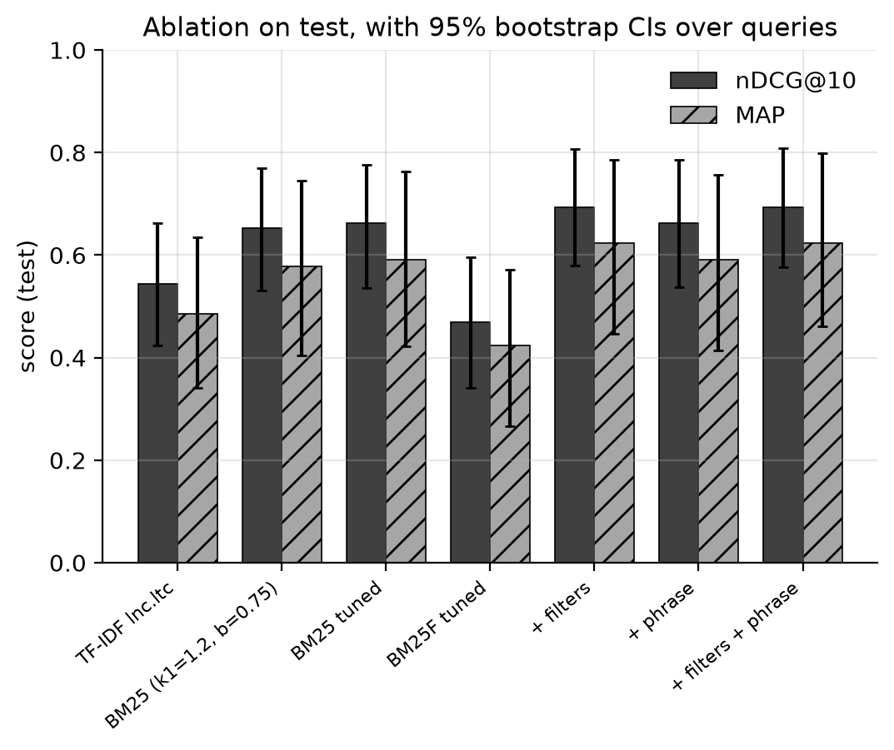
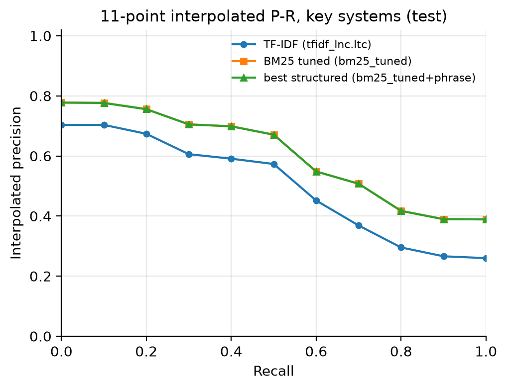
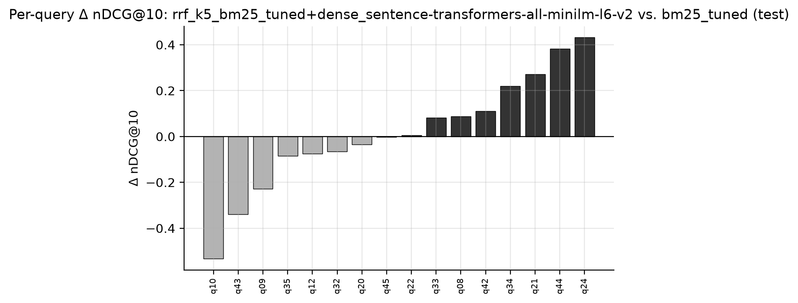
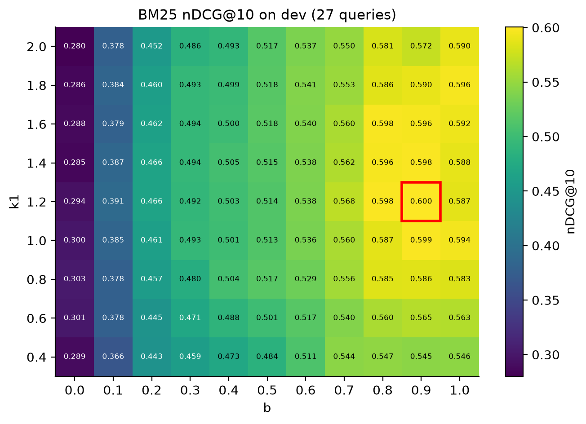

# 8. Experiments

> Report sections 8.1-8.4 (owner A). Tables are included from `results/ablation_*.md`, written
> by `scripts/ablation.py`; other numbers come from the `results/` file named next to them.
> Section 8.5 (graph, trust and attacks) follows.

## 8.1 Test collection and protocol

**Queries.** The 45 queries (`queries/queries.jsonl`) cover four needs: spec queries with hard
constraints ("5G phone under $300"), aspect queries ("phone with a great camera for low
light"), model queries ("Google Pixel 7a") and vague queries ("phone that does everything
well"). They are split once into 27 dev queries (7 spec, 7 aspect, 7 model, 6 vague) and 18
test queries (5, 5, 4, 4). Twelve queries carry a structured filter written with the query
(7 dev, 5 test); for the others the constraint parser of Section 7.2 may derive one.

**Judgments.** For each query the top 5 phones of five systems (TF-IDF, BM25 with default
parameters, Rocchio, HyDE with Rocchio, dense retrieval) were pooled and graded 0-3 by an LLM
judge that sees the query, its labelling notes and the phone's listing, but not its ratings,
reviews or which system found it. Queries with no relevant phone after that were re-pooled to
depth 10. This gives 800 graded pairs (495 dev, 305 test): 182 graded 0, 375 graded 1, 115
graded 2 and 128 graded 3. On 89 test pairs labelled by all three of us, the judge agrees with
the human grades with Cohen's $\kappa = 0.26$ on the four grades (weighted $\kappa = 0.48$,
$\kappa = 0.39$ for relevant versus not relevant; `results/kappa.json`). The final qrels use
the LLM grades; Section 9 shows that scoring with the human grades leaves the order of the
systems unchanged.

**Protocol.** A phone is relevant for the binary metrics when its grade is at least 2; nDCG
uses the grades with gain $2^g - 1$ (Section 7.10). Six queries have no relevant phone in the
pool (q04, q27, q29, q31 on dev, q11 and q23 on test): three ask for models that are not in
the collection, and three depend on information the listings rarely state or the judge does
not see (a price, star ratings, long software support). They stay in the query file but are excluded from every average,
leaving **23 dev and 16 test queries**. Every parameter (BM25 $k_1$ and $b$, BM25F field
weights, the phrase weight, Rocchio and HyDE weights, the RRF constant, fusion weights, the
prior weights) was chosen on the dev queries only, and each test run was written once with
the dev-chosen setting. Systems are compared with a two-sided paired randomization test
(10,000 permutations) on per-query scores, Holm-corrected when several systems are compared
with one baseline.

**Pool coverage.** Phones outside the pool count as non-relevant, and the pool is shallow: even
tuned BM25 has only 62% of its test top 10 judged (judged@10 = 0.62). A system that surfaces
phones none of the pooled systems retrieved is therefore scored as a lower bound. The tables
mark every row with judged@10 below 0.7 with ‡.

## 8.2 Main results

Table 8.1 lists every system on the test queries. "Best overall" is the system with the
highest **dev** nDCG@10, reported on test; the dev table is in Appendix A.

<!-- include: results/ablation_test.md -->

*Table 8.1. All systems on the 16 scored test queries (`results/ablation_test.md`).*

*Figure 8.1. nDCG@10 and MAP per system on the test queries, with 95% bootstrap confidence
intervals over queries (1,000 resamples).*

**The system chosen on dev is RRF of tuned BM25 and dense retrieval.** It has the highest dev
nDCG@10 (0.642, against 0.600 for tuned BM25) and reaches 0.677 on test, 0.014 above tuned BM25
(0.663). It also retrieves the best-covered top 10 (judged@10 = 0.86) and has the highest test
P@10 (0.412) and R@10 (0.724). Weighted linear fusion behaves the same way (0.621 dev, 0.681
test). Fusion beats its best single input on both splits, but on 16 test queries neither gain
is significant (8 better / 8 worse queries for RRF, $p = 0.82$).

**No system is significantly better than tuned BM25.** After Holm correction across all rows,
the only significant difference in Table 8.1 is BM25F, which is worse (Section 8.3). The highest
test nDCG@10, 0.693, belongs to BM25 with spec filters, but filters scored below tuned BM25 on
dev (0.562 against 0.600), so the protocol does not pick them; Section 8.4 explains the split.

**Dense retrieval alone is weak here.** The off-the-shelf all-MiniLM-L6-v2 encoder reaches
0.417 test nDCG@10, 0.246 below tuned BM25 (unadjusted $p = 0.03$, Holm-adjusted $p = 0.32$).
Its main contribution is as a second, different ranker for fusion.

**Feedback and expansion stay close to their TF-IDF base.** Tuned Rocchio loses 0.017 nDCG@10
against TF-IDF on test and HyDE gains 0.021; neither difference is significant (Table 8.2).
On dev, HyDE (0.586) is well ahead of TF-IDF (0.522) and Rocchio (0.507).

**Graph and trust priors change little** (−0.003 to +0.011 against tuned BM25; Section 8.5.4).

<!-- include: results/ablation_incremental.md#test -->

*Table 8.2. Each system against the system it builds on, test queries
(`results/ablation_incremental.md`). With several parents the one that is better on dev is
used. $p$ is uncorrected.*

**By query type** (RQ1), dense retrieval is below tuned BM25 on every type and fails on spec
queries, whose constraints are numbers and units that a general sentence encoder does not
match (test nDCG@10 0.083 against 0.704). Fusion gains most on aspect queries.

| Test nDCG@10 by type | spec (4) | aspect (4) | model (4) | vague (4) |
|---|---:|---:|---:|---:|
| BM25 tuned | 0.704 | 0.630 | 0.739 | 0.578 |
| Dense | 0.083 | 0.533 | 0.722 | 0.331 |
| RRF (BM25, dense) | 0.517 | 0.798 | 0.777 | 0.616 |
| HyDE | 0.552 | 0.558 | 0.587 | 0.560 |
| BM25 tuned + filters | 0.825 | 0.630 | 0.739 | 0.578 |

*Table 8.3. Test nDCG@10 per query type (number of scored queries in brackets), from the
per-query values in `results/<run>_test.json`. With four queries per type these are
indications, not tests.*

*Figure 8.2. Interpolated precision-recall on the test queries for TF-IDF, tuned BM25, the best
structured, neural and overall systems.*

*Figure 8.3. Per-query change in test nDCG@10 of the best system (RRF) against tuned BM25,
sorted. The mean gain of 0.014 hides large changes in both directions on single queries.*

## 8.3 Lexical baselines and tuning

**BM25 against TF-IDF.** With textbook parameters ($k_1 = 1.2$, $b = 0.75$) BM25 beats lnc.ltc
TF-IDF by 0.109 test nDCG@10 (9 better / 7 worse queries, $p = 0.07$) and by 0.066 on dev.
Both were pooled systems, so the gap is not a pooling artefact, although TF-IDF's top 10 is
better covered (judged@10 0.78 against 0.61).

**Tuning $k_1$ and $b$.** A grid of $k_1 \in \{0.4, \dots, 2.0\}$ and $b \in \{0, 0.1, \dots,
1\}$ on the dev queries (`scripts/tune_bm25.py`, `results/bm25_tuning.json`) picks $k_1 =
1.2$, $b = 0.9$: dev nDCG@10 0.600 against 0.588 at the default. The surface is flat around
the optimum (Figure 8.4), and on test the tuned setting adds only 0.010 (4 better / 8 worse
queries, $p = 0.88$). The chosen $b = 0.9$ normalises for listing length more strongly than the
default.

*Figure 8.4. Dev nDCG@10 of BM25 over $k_1$ and $b$; the chosen cell is outlined.*

**BM25F is much worse, partly for a measurement reason.** The best field weights on dev are
equal (title, features, description = 1, 1, 1) and still give only 0.330 dev and 0.469 test
nDCG@10, the one significant loss in Table 8.1 (−0.194 on test, 1 better / 14 worse queries).
Two causes add up. First, our BM25F-lite sums per-field BM25 scores, so a query term that
appears in the title, the features and the description is counted three times, which favours
listings that repeat words over listings that match the need. Second, only 37% of BM25F's test
top 10 is judged, because no pooled system searched the fields separately; its true score is
higher than measured, by an amount we cannot estimate.

**Phrase boost.** A boost for exact phrase matches (quoted phrases and a list of common
two-word features such as "wireless charging") was tuned on dev over $\{0.5, 1, 2, 4\}$ and set
to 0.5. Only 2 dev queries and no test query contain such a phrase, so it changes no test
result (Table 8.2) and slightly lowers dev nDCG@10 (0.598 against 0.600 without it).

## 8.4 Spec filters, efficiency and failure cases

**Filters help where they apply, on test.** Spec filters only change queries that have a
constraint (`results/filters_subset_*.json`). On the 4 scored test queries with one, filtered
BM25 rises from 0.704 to 0.825 nDCG@10 ($p = 0.12$); the other 12 are unchanged. On the 9 dev
queries with a constraint it falls from 0.519 to 0.422 ($p = 0.21$). Two effects explain the
dev loss. Under the null policy of Section 7.2 every phone with an unknown value for a
constrained field is removed, and prices are known for only 23% of phones, so price filters
remove most relevant-looking phones. And the filtered runs bring in phones that were never
judged: judged@10 on the constrained dev queries drops from 0.70 to 0.31. The filters source
their constraints from the query file where B wrote one (7 dev and 5 test queries) and from the
rule-based parser otherwise (4 more dev queries).

**Efficiency.** All rankers are pure Python on one core over 7,166 phones. A test query takes
5.7 ms on average for tuned BM25, 9.4 ms for TF-IDF and 13.5 ms for BM25F, which scores three
fields (`results/latency_*_test.json`; timings on a laptop, so only their ratios matter). For Boolean AND queries, skip pointers on the postings lists cut the
number of comparisons by 36% (212.8 against 330.4 on average over 200 random 2-3 term queries)
and the mean latency by a factor of 1.13 (`results/efficiency.json`); the small speed-up reflects
that building the candidate lists, which is the same with and without skips, dominates the time
at this collection size.

**Failure cases.** `results/failure_cases.md` lists the three test queries where the chosen RRF
system scores lowest and the two where it loses most against tuned BM25, with their top 5 and
the relevant phones they miss.

* *q08 "cheap phone under $150 with 64GB storage"* (0.321): the top 5 are small phones with
  8-16 GB of storage where it is stated, mostly graded marginal; the relevant phones are
  ranked 33rd or lower or not retrieved, and 8 of the 12 have no listed price.
* *q42 "phone that does everything well"* (0.445): the top 5 are old, generic listings
  (feature phones, a listing titled "Phones"), all graded marginal (1).
* *q10 "2023 phone with 5G support"* (0.350, tuned BM25 0.883), *q43 "phone for content
  creators"* (0.477, tuned BM25 0.817) and *q09 "flagship phone with 12GB RAM and 512GB
  storage"* (0.708, tuned BM25 0.936) fail the same way. On all three, dense retrieval's top 5
  are graded 0, while tuned BM25 has at least four relevant phones in its top 6. With the small
  RRF constant chosen on dev ($k = 5$), the fused top 5 alternates the two lists (the first
  result of each, then the second of each), so every second position is a non-relevant phone
  from the dense run.

The last three cases show the cost of fusion with a weak second ranker: RRF cannot tell when
one of its inputs has nothing useful for a query.
